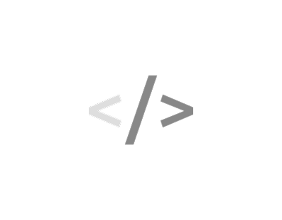

  
  <h1>Node-PS</h1>
  
<em>nodePS 플랫폼, 격리 컨테이너 런타임 및 문제해결/대전 시스템 개발 그룹</em>

 

**Node-PS**는 격리된 샌드박스 환경에서의 문제 해결(Problem Solving), 대전(War) 시뮬레이션 및 독립 런타임 확장을 위한 컨테이너 인프라와 서비스 플랫폼을 개발하는 그룹입니다.

---

## 📌 주요 프로젝트 (Key Projects)
- **`nodeps-service`**: PS 플랫폼 코어 서비스 및 분산 작업 스케줄링 API
- **`nodeps-container-image`**: 경량 격리 실행 환경 및 채점/실행용 맞춤형 컨테이너 이미지
- **`nodeps-extension-code`**: VS Code 및 브라우저 기반 실시간 코드 연동 익스텐션
- **`account-app`**: 사용자 인증, 세션 관리 및 프로필 연동 서비스

---
* **Project Manager / Owner**: limmireu1214@gmail.com (@Mireu-Lab)

